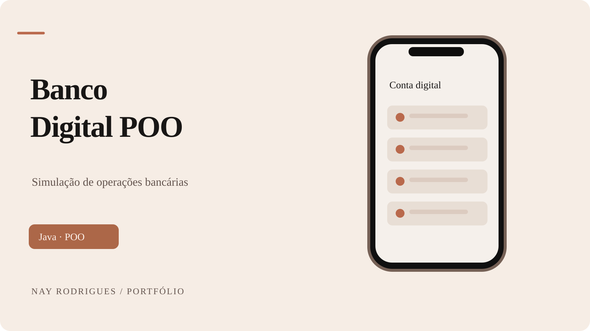

<div align="center">



# Banco Digital com POO

Aplicação Java com clientes e operações bancárias básicas, desenvolvida como exercício do Santander + DIO

**Bootcamp Santander + DIO**

</div>


Projeto prático desenvolvido no **Bootcamp Santander | DIO**, com o objetivo de reforçar os conceitos de **Programação Orientada a Objetos (POO)** em Java através da abstração de um **banco digital**.

O sistema permite criar clientes, contas **Corrente** e **Poupança**, realizar **depósitos, saques e transferências** entre contas da mesma instituição.
---

## Como Executar
```bash
# entrar na pasta src
cd src

# compilar todos os arquivos
javac *.java

# executar a aplicação
java Main
```

## Estrutura
```
src/
 ├── Banco.java
 ├── Cliente.java
 ├── Conta.java
 ├── ContaCorrente.java
 ├── ContaPoupanca.java
 └── Main.java
```
